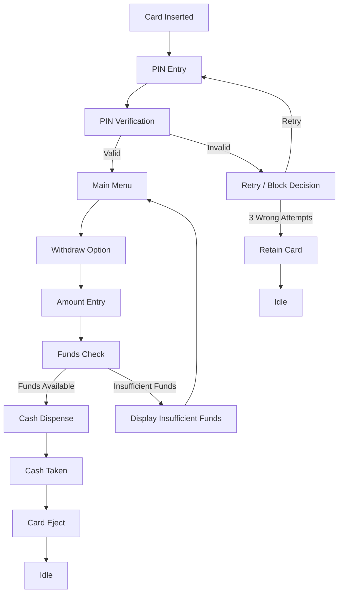

<div align="center">

# ATM Controller FSM

<p>
  
  
  
  
</p>

<h3>Secure Transaction Logic for an ATM Machine</h3>

</div>

## Overview

This project presents a robust finite-state-machine (FSM)-based ATM controller implemented in Verilog HDL. It models the core behavior of a modern ATM system, including card insertion, PIN validation, menu navigation, amount entry, fund checking, cash dispensing, card ejection, and card retention after repeated invalid PIN attempts.

The design emphasizes deterministic control logic, transactional safety, and clean hardware-level state transitions. It is suitable for digital design learning, RTL simulation, and understanding how embedded banking hardware behaves at the control layer.

## Why This Project Stands Out

- Realistic ATM transaction flow modeled as a digital state machine
- Clear hardware-oriented control logic
- Built-in wrong-PIN attempt handling and card blocking
- Ready for simulation and RTL validation using standard Verilog tools
- Strong demonstration of FSM design in digital electronics

## Block Diagram



## State Machine Architecture

The controller is implemented as a Moore FSM, where outputs depend only on the current state. The system transitions through the following primary states:

- IDLE
- PIN_ENTRY
- PIN_CHECK
- MENU
- AMOUNT_ENTRY
- FUNDS_CHECK
- DISPENSE
- NO_FUNDS
- EJECT_CARD
- CARD_BLOCKED

## Functional Behavior

### 1. Card Insertion
When a card is inserted, the system moves from IDLE to PIN_ENTRY and prompts the user to enter a PIN.

### 2. PIN Authentication
The controller checks whether the entered PIN is valid. If valid, the user is granted access to the banking menu. If invalid, the attempt counter increments and the user is asked to retry.

### 3. Transaction Flow
After successful authentication:
- user selects withdrawal
- amount is entered
- balance is checked
- cash is dispensed if sufficient funds exist
- card is ejected after cash collection

### 4. Security Rules
- Three failed PIN attempts block the card
- Insufficient funds route the user back to the menu flow
- Cancel operations can trigger safe card ejection

## Project Structure

```text
ATM_CONTROLLER_FSM/
├── atm_controller.v       # ATM FSM RTL design
├── atm_controller_tb.v    # Testbench for functional verification
├── README.md             # Project documentation
└── .gitignore            # Git ignore file (if present)
```

## Design Highlights

- Modular and easy to understand Verilog implementation
- Event-driven finite state transitions
- Controlled output behavior using Moore machine design principles
- Realistic error handling for invalid PINs and insufficient funds
- Suitable for teaching FSM logic or as a digital design reference

## Simulation and Verification

This project includes a complete testbench to validate successful and edge-case transaction scenarios.

### Run simulation (Icarus Verilog)

```bash
iverilog -o atm_controller_tb atm_controller.v atm_controller_tb.v
vvp atm_controller_tb
```

### Verified scenarios

- Valid PIN + sufficient funds + cash withdrawal
- Wrong PIN followed by valid retry
- Insufficient funds transaction
- Three invalid PIN attempts leading to card retention
- Cancel and card ejection flow

## Technical Snapshot

| Aspect | Description |
|---|---|
| Design Type | Finite State Machine (Moore machine) |
| Implementation | Verilog HDL |
| Application | ATM control logic |
| Core Features | PIN check, transaction flow, cash dispense, fault handling |
| Target Use | Digital system design and RTL simulation |

## About the Project

The ATM Controller FSM project is a digital hardware design that captures the control logic behind automatic teller machine transactions. Built with a focus on engineering clarity and real-world banking behavior, the project demonstrates how sequential logic and state-based design can represent secure and deterministic machine operations in a hardware description language.

This design reflects the kind of systems engineers develop when building logic for embedded control, banking hardware, and digital transaction interfaces. It is a compact yet practical example of how complex decision-making can be represented cleanly through finite-state control.

## About the Developer

This project is developed by Abiraman, with a focus on building elegant digital logic designs that combine practicality, performance, and clarity.

## License

This project is for educational and engineering demonstration purposes. Please respect open-source usage standards and credit the original author when reusing the design.

---

<p align="center">
  <strong>Designed and developed by Abiraman</strong>
</p>
